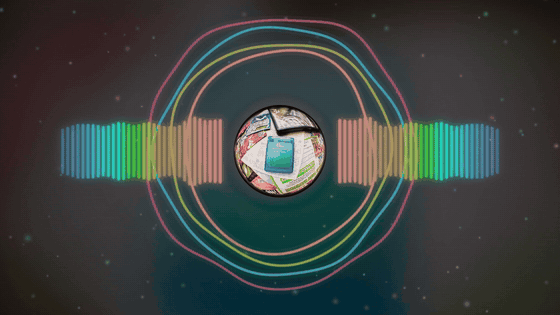

# afterglow-viz
Audio-reactive visualizer and ambient backdrop for Spotify, built as a Spicetify custom app

<p align="center">
  
  
</p>

Rings, bars, particles and the album art, all moving with the song. It uses Spotify's own analysis of each track, so the beats and loudness actually line up.

## Install

### 1. Get Spicetify

[Spicetify](https://spicetify.app) ([GitHub](https://github.com/spicetify/cli)) is what lets Spotify run custom apps like this one. Skip this step if you already have it. Close Spotify first.

> **Windows users:** Spotify has to be the version from [spotify.com/download](https://www.spotify.com/download). The Microsoft Store version won't work with Spicetify.

- **Windows:** open PowerShell and paste this:
  ```
  iwr -useb https://raw.githubusercontent.com/spicetify/cli/main/install.ps1 | iex
  ```
- **Mac or Linux:** open Terminal and paste this:
  ```
  curl -fsSL https://raw.githubusercontent.com/spicetify/cli/main/install.sh | sh
  ```

When it's done, close that window and open a new one.

### 2. Add afterglow-viz

Paste one line, the same way as above:

- **Windows (PowerShell):**
  ```
  iwr -useb https://raw.githubusercontent.com/sjdsjadjajdjsa/afterglow-viz/main/install.ps1 | iex
  ```
- **Mac or Linux (Terminal):**
  ```
  curl -fsSL https://raw.githubusercontent.com/sjdsjadjajdjsa/afterglow-viz/main/install.sh | sh
  ```

Spotify restarts. Click the afterglow-viz icon in the sidebar and play a song.

<details>
<summary>Rather do it by hand?</summary>

1. Download [afterglow-viz.zip](https://github.com/sjdsjadjajdjsa/afterglow-viz/releases/latest/download/afterglow-viz.zip).
2. Open your `CustomApps` folder:
   - **Windows:** press Win + R, paste `%appdata%\spicetify\CustomApps` and press Enter.
   - **Mac or Linux:** it's `~/.config/spicetify/CustomApps`.

   If the folder isn't there, make it.
3. Unzip the download into that folder, so you have a folder called `afterglow-viz` inside `CustomApps`.
4. Run:
   ```
   spicetify config custom_apps afterglow-viz
   spicetify apply
   ```

</details>

### Updating

Run the same line from step 2 again.

If the app disappears after Spotify updates itself, run `spicetify apply`.

## Using it

- Move your mouse near the bottom for play controls, settings and full view.
- In settings, pick a look, or mix your own and save it.
- Full view fills the Spotify window. Esc goes back.

## Build it yourself

Needs Node 22.12 or newer.

```
npm install
npm run install-local
```

`npm run dev` opens a test page with a fake Spotify player at http://127.0.0.1:5173/dev.html.
